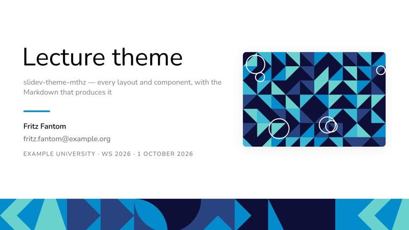
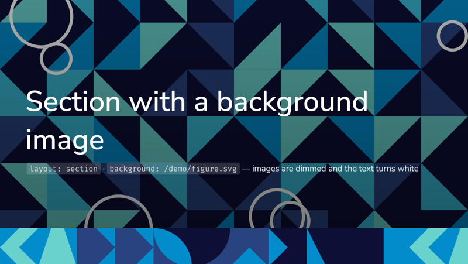
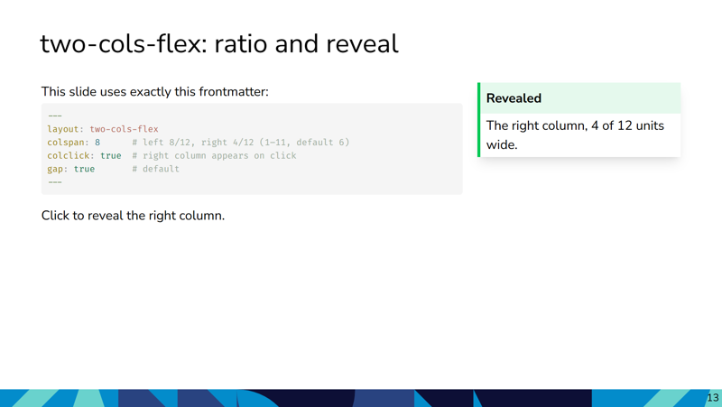
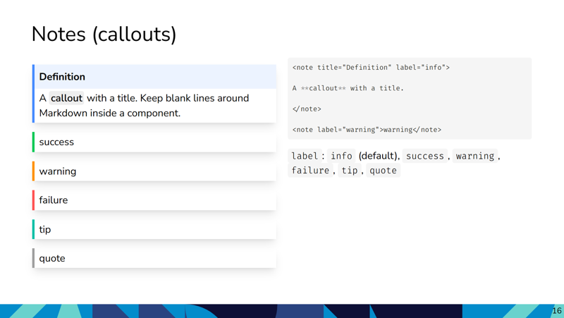
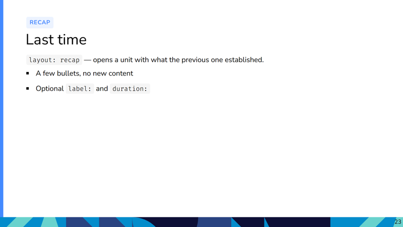
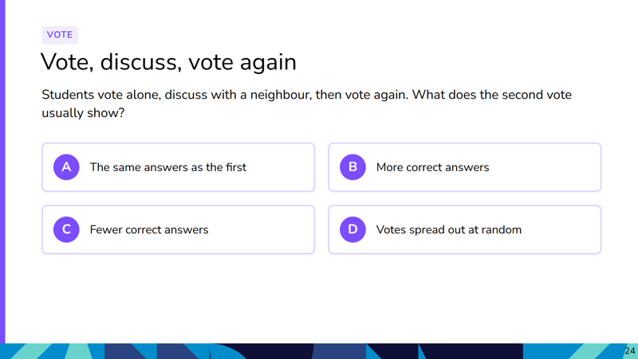
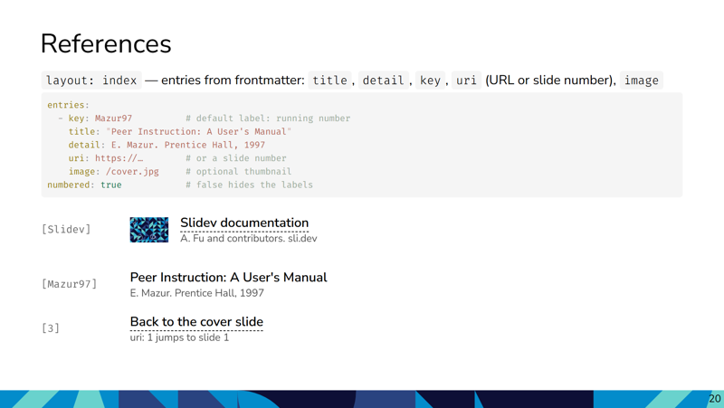
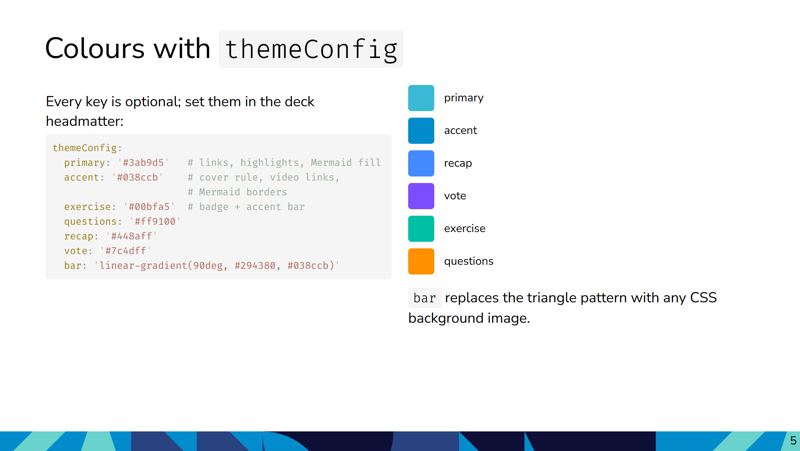

# slidev-theme-mthz

A clean, content-first theme for [Slidev](https://github.com/slidevjs/slidev) — built for lecture decks and academic talks. Requires Slidev **≥ 53**. Light-only (`colorSchema: light` is set by the theme).

**Live demo of every layout and component: <https://mthz.github.io/slidev-theme-mthz/>** (source: [`example.md`](example.md)).

| | |
|---|---|
|  |  |
|  |  |
|  |  |
|  |  |

## Install

The theme is installed straight from GitHub (it is not on npm).

**New deck** (Node ≥ 22.12, pnpm):

```bash
pnpm create slidev my-lecture
cd my-lecture
pnpm add github:mthz/slidev-theme-mthz#v0.2.0   # pinned release tag (recommended)
pnpm add github:mthz/slidev-theme-mthz          # or latest main
```

Slidev 53 currently breaks on a fresh install because it pulls in `markdown-it` 15, which its markdown parser does not support yet (`ERR_PACKAGE_PATH_NOT_EXPORTED … markdown-it/lib/token.mjs`). Pin it in the deck's `pnpm-workspace.yaml` (create the file if it doesn't exist) and run `pnpm install` again:

```yaml
overrides:
  markdown-it: ^14.1.0
```

Then in the headmatter of `slides.md`:

```yaml
---
theme: mthz
title: My lecture
author: Fritz Fantom                 # optional, shown on the cover (see Cover)
institution: Example University
semester: WS 2026
---
```

Update later with `pnpm update slidev-theme-mthz`.

**Editing the theme alongside your decks** (git submodule, referenced by path):

```bash
git submodule add https://github.com/mthz/slidev-theme-mthz slidev-theme-mthz
pnpm add @fontsource-variable/fira-code @fontsource-variable/nunito-sans @iconify-json/mdi
```

```yaml
theme: ./slidev-theme-mthz
```

**Windows:** the theme ships a `vite.config.ts` that works around a Vite 8 bug with drive-letter paths. Slidev merges it into every deck that uses the theme, so you don't need your own copy.

**Preview the theme itself:**

```bash
git clone https://github.com/mthz/slidev-theme-mthz
cd slidev-theme-mthz
pnpm install
pnpm run dev      # opens example.md, a demo of every layout and component
```

### Coding agents (Claude Code & co.)

The theme ships an agent skill, `skills/slidev-theme-mthz/SKILL.md`, describing its layouts, components and conventions. Copy it into your deck project so the agent uses the theme's layouts instead of hand-written HTML:

```bash
# after installing the theme
cp -r node_modules/slidev-theme-mthz/skills/slidev-theme-mthz .claude/skills/
# Slidev's own skill is worth adding too
cp -r node_modules/@slidev/cli/skills/slidev .claude/skills/
```

Re-copy after updating the theme (or add a `sync-skills` script to your `package.json` that does it).

## Layouts

| Layout | Use |
|---|---|
| `cover` | Title slide: `# title`, optional subtitle paragraph, `image:` on the right (`imageAlt:`), info block from headmatter (see below). `background:` takes a CSS color, gradient or image URL (images are dimmed and get white text). |
| `intro` | Block opener. Accepts `background:`. Same cover-bar styling, no big title styling. |
| `section` | Divider between blocks. Accepts `background:`. Cover styling plus `.section` rules. |
| `default` | Vanilla single-column page **with two-column slots** — see *two-column behaviour* below. |
| `two-cols-flex` | Explicit two-column layout (identical to `default` — use whichever reads better). |
| `image-header-intro` | Intro with one header image + optional right-side image (`imageHeader:`, `imageRight:`). |
| `toc` | Table of contents (Slidev's `<Toc/>`); heading in the slot, default "Table of Contents". `columns:`, `minDepth:`, `maxDepth:`, `mode:` are passed to `<Toc/>`. |
| `index` | Numbered list for references, literature, image sources. Entries from frontmatter, see *Index* below. |
| `exercise` | In-lecture hands-on. Teal badge "Exercise" + left accent bar. Optional `duration:` (e.g. `5 min`) and `label:`. |
| `questions` | Understanding questions at the end of a unit. Orange badge "Check your understanding". Optional `label:`. |
| `recap` | Recap of the previous unit. Blue badge "Recap". Optional `label:`. |
| `vote` | Peer-instruction vote question (one per unit). Purple badge "Vote". Content: `# title`, a lead-in line, a numbered list `1.`–`4.` → answer cards A–D; Optional `label:`. |
| `end` | Closing slide in cover style (replaces Slidev's black `end`). Empty slot → "Thank you". Accepts `background:`. |

Slidev's other built-in layouts (`center`, `fact`, `statement`, `quote`, `image`, `image-left`, `image-right`, `two-cols`, `two-cols-header`, `full`, `iframe…`) work as usual and pick up the theme's typography; the demo shows them.

### Teaching scheme

The four block layouts share one look (badge + coloured accent bar), so the recurring parts of a unit are recognisable in every course:

1. `recap` opens a unit with the previous one in a few lines.
2. Content slides.
3. `vote`: one peer-instruction question per unit; the class votes A–D, discusses in pairs, votes again.
4. `exercise`: hands-on task or lecturer-led discussion case, optional `duration:`.
5. `questions`: understanding questions that close the unit.

The badge text is English; override it per slide with `label:`.

### Cover

```yaml
# deck headmatter (first slide)
author: Fritz Fantom
email: fritz.fantom@example.org
institution: Example University
semester: WS 2026
date: 7 October 2026
---
# cover slide
layout: cover
image: /cover.png
imageAlt: Course illustration
---

# Lecture title

Optional subtitle
```

The info block shows author, email and one line `institution · semester · date`. It is shown on the first slide when `author` is set; force it with `meta: true` / `meta: false`. A slide can override `email`, `institution`, `semester` and `date` in its own frontmatter.

### Colours (`themeConfig`)

All colours have defaults; a deck overrides any of them in its headmatter:

```yaml
themeConfig:
  primary: '#3ab9d5'    # Slidev's primary (links, highlights); also Mermaid node fill
  accent: '#038ccb'     # cover accent rule, LectureVideo links, Mermaid borders
  exercise: '#00bfa5'   # badge + accent bar of the block layouts
  questions: '#ff9100'
  recap: '#448aff'
  vote: '#7c4dff'
  bar: 'linear-gradient(90deg, #294380, #038ccb)'   # any CSS background image; replaces the bar pattern
```

Mermaid diagrams use the theme palette (`setup/mermaid.ts`; `primary` and `accent` must be `#rrggbb` to apply there). A diagram can still opt out: ```` ```mermaid {theme: 'neutral'} ````.

### Index

```yaml
---
layout: index
entries:
  - key: Smith20                      # optional label, default: running number
    title: Book or paper title         # required, bold
    detail: A. Smith, B. Jones. Publisher, 2020
    image: /smith20_cover.jpg          # optional thumbnail
    uri: https://example.org/…        # URL → new tab; a slide number → jump to that slide
numbered: true                         # false hides numbers / keys
---

# Literature
```

### Two-column behaviour

`default` and `two-cols-flex` provide the same `::left::` / `::right::` slot pattern with a tunable column ratio:

```yaml
---
layout: two-cols-flex
colspan: 7        # left gets 7/12, right gets 5/12 (1–11, default 6)
gap: true         # gap between columns (default true)
colclick: false   # if true, wrap right column in a v-click
---

::left::

Left content.

::right::

Right content.

::bottom::

Optional full-width content below both columns.
```

The default layout intentionally behaves the same way (`layouts/default.vue` wraps `two-cols-flex`), so `::left::` works without specifying a layout. The column grid is only rendered when `::left::` or `::right::` is used.

## Components

| Component | Description |
|---|---|
| `<Figure src cite title caption width />` | Image with optional caption and citation. Centers automatically. |
| `<note label title>` | Coloured callout box. `label` ∈ `info` (default), `success`, `warning`, `failure`, `tip`, `quote`. |
| `<Footnotes x y filled separator><Footnote number>` | Footnote list anchored to the bottom of a slide (`x`: `l` / `r`, `y`: `row` / `col` to stack entries). |
| `<pdf src page>` | Embedded PDF (`src` required). |
| `<LectureVideo src poster export-poster youtube link link-label />` | Local video in the live lecture. In the PDF export it becomes a still (`export-poster`, else `poster`) linking to YouTube (`youtube` = video ID), plus an optional `link`. Videos don't need to be committed; the export only needs the poster. |
| `<tag>` | Inline gray pill — `<tag>place</tag>`. |
| `<hl>` | Inline cyan highlight — `<hl>important</hl>`. |
| `<cite>` | Tiny italic citation under figures or below quotes. |

Example:

```markdown
<note title="Definition" label="info">

A **pinhole camera** projects a 3D scene onto a 2D image plane through a single point.

</note>

<Figure src="/pinhole.svg" cite="Forsyth & Ponce, 2011" width="400"/>
```

### Helpers for your own components

`layout-helper.ts` exports `resolveAssetUrl` (prefixes `/…` paths with the deck's base URL, needed when a deck is built under a sub-path) and `handleBackground`:

```ts
import { resolveAssetUrl } from 'slidev-theme-mthz/layout-helper'     // installed via pnpm
import { resolveAssetUrl } from '../slidev-theme-mthz/layout-helper'  // submodule
```

## Tweaks vs. Slidev defaults

* **Shiki themes:** `vitesse-light` / `vitesse-dark` (configurable in `setup/shiki.ts`).
* **Fonts:** Avenir Next if installed, else Nunito Sans (sans); Fira Code (mono). Nunito Sans and Fira Code are bundled from `@fontsource-variable` (`fonts.provider: none`), so decks work offline.
* **`strong`** is given a subtle pill background to mark inline emphasis.
* **`h1` + `p`** sequences get tightened spacing (a common subtitle pattern).
* Page numbers come from `slide-bottom.vue` (per-slide layer, so they are right in PDF export and the overview): in the cover bar on normal slides, as a small number without the bar on `image*`, `full` and `iframe*` slides, none on `cover` and `end`.
* **Mermaid** diagrams in the theme palette (`setup/mermaid.ts`).

## Theme structure

```
slidev-theme-mthz/
├── package.json          # slidev.colorSchema / fonts defaults
├── vite.config.ts        # Windows / Vite 8 workaround, merged into every deck
├── setup/                # shiki.ts (code highlighting), mermaid.ts (diagram palette)
├── layout-helper.ts      # resolveAssetUrl + background style helper
├── slide-bottom.vue      # page-number footer (per slide)
├── layouts/              # custom layouts
├── components/           # Figure, note, Footnote(s), pdf, LectureVideo, hl, tag, BlockLayout
├── styles/
│   ├── index.ts          # entry — inherits Slidev base styles
│   └── layouts.css       # main theme CSS
├── assets/               # bar.svg
├── skills/               # agent skill (SKILL.md) for decks using the theme
├── example.md            # demo of every layout and component
├── public/demo/          # demo-only assets (not in the package)
├── screenshots/          # README images (not in the package)
└── .github/workflows/    # builds example.md → GitHub Pages
```

## Contributing

```bash
pnpm install
pnpm run dev        # preview example.md
pnpm run build      # static SPA
pnpm run export     # → example.pdf
```

Edit `example.md` to test new components/layouts in isolation. Every push to `main` rebuilds the live demo. README screenshots: `pnpm run screenshot` (writes `shots/`), then copy the chosen slides into `screenshots/`.

Releases: bump `version` in `package.json`, then `git tag v0.x.y && git push --tags`; decks pin a release with `github:mthz/slidev-theme-mthz#v0.x.y`. The package is marked `private`, so it can't be published to npm by accident.

## Colour palette

Defaults: primary `#3ab9d5` (Slidev's), accent `#038ccb`; block layouts teal `#00bfa5` (exercise), orange `#ff9100` (questions), blue `#448aff` (recap), purple `#7c4dff` (vote). The cover-bar pattern (`assets/bar.svg`) uses `#038ccb`, `#294380`, `#69d2cd` and `#0d0f36`. Override them with `themeConfig` (see *Colours*).
