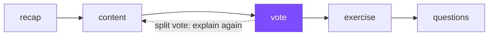
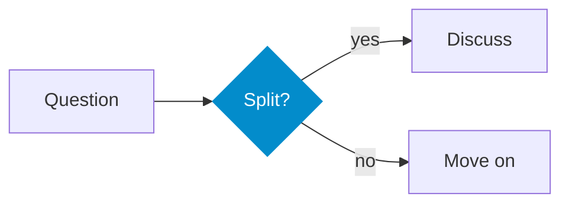

# Lecture theme

slidev-theme-mthz — every layout and component, with the Markdown that produces it

<!--
Presenter notes go in an HTML comment at the end of a slide.
The info block below the title comes from the headmatter: author, email, institution, semester, date.
-->

---
layout: toc
columns: 3
class: text-sm
---

# Contents

---
layout: section
---

# 1 · Deck setup

Cover, colours, intro, section, image-header-intro, toc, end

---

# The cover slide

::left::

The first slide. Its info block is read from the deck **headmatter**:

```yaml
---
theme: mthz
layout: cover
image: /cover.svg      # optional, right side
imageAlt: …
author: Fritz Fantom
email: fritz.fantom@example.org
institution: Example University
semester: WS 2026
date: 1 October 2026
---

# Deck title

Subtitle paragraph
```

::right::

- Info block appears on slide 1 when `author` is set
- `meta: true` / `meta: false` forces it on or off
- A slide may override `email`, `institution`, `semester`, `date`
- `background:` takes a colour, gradient or image (dimmed, white text)

---

# Colours with `themeConfig`

::left::

Every key is optional; set them in the deck headmatter:

```yaml
themeConfig:
  primary: '#3ab9d5'   # links, highlights, Mermaid fill
  accent: '#038ccb'    # cover rule, video links,
                       # Mermaid borders
  exercise: '#00bfa5'  # badge + accent bar
  questions: '#ff9100'
  recap: '#448aff'
  vote: '#7c4dff'
  bar: 'linear-gradient(90deg, #294380, #038ccb)'
```

::right::

<div class="flex flex-col gap-2 mt-2 text-sm">
  <div class="flex items-center gap-3"><span class="w-8 h-8 rounded" style="background:#3ab9d5"></span> primary</div>
  <div class="flex items-center gap-3"><span class="w-8 h-8 rounded" style="background:#038ccb"></span> accent</div>
  <div class="flex items-center gap-3"><span class="w-8 h-8 rounded" style="background:#448aff"></span> recap</div>
  <div class="flex items-center gap-3"><span class="w-8 h-8 rounded" style="background:#7c4dff"></span> vote</div>
  <div class="flex items-center gap-3"><span class="w-8 h-8 rounded" style="background:#00bfa5"></span> exercise</div>
  <div class="flex items-center gap-3"><span class="w-8 h-8 rounded" style="background:#ff9100"></span> questions</div>
</div>

`bar` replaces the triangle pattern with any CSS background image.

---
layout: intro
---

# Intro

`layout: intro` — opens a block of the lecture. Title, one line below it, the cover bar at the bottom.

```yaml
layout: intro
```

---
layout: section
background: /demo/figure.svg
---

# Section with a background image

`layout: section` · `background: /demo/figure.svg` — images are dimmed and the text turns white

---
layout: image-header-intro
imageHeader: /demo/figure.svg
imageRight: /demo/figure.svg
---

# image-header-intro

Chapter opener with a header image and an optional image on the right.

```yaml
layout: image-header-intro
imageHeader: /demo/figure.svg
imageRight: /demo/figure.svg    # optional
```

---

# Table of contents and closing slide

::left::

```yaml
---
layout: toc
columns: 3        # passed to Slidev's <Toc/>
                  # also: minDepth, maxDepth, mode
class: text-sm    # any slide: extra CSS classes
---

# Contents
```

Slide 2 of this deck uses it. Without a heading the slide says "Table of Contents".

::right::

```yaml
---
layout: end
---

# Thank you

Questions: fritz.fantom@example.org
```

Cover style, no page number. Empty slot → "Thank you". See the last slide.

---
layout: section
---

# 2 · Content layouts

One column, two columns, tunable ratio

---

# Default layout

The default layout is a plain page. Headings, text and lists use the theme's typography:

###### Kicker line

- `######` gives the small grey kicker line above
- Lists have a little air between items,
  but wrapped lines stay tight
- **Bold** marks a key term as a tinted pill — use it sparingly
- `inline code`, [links](https://sli.dev) and <hl>highlights</hl>

| Feature | Default | Theme |
|---|---|---|
| Table cells | loose | tight |
| Font | system | Nunito Sans / Avenir Next |

---

# Two columns without a layout key

::left::

`default` understands the column slots, so no `layout:` is needed:

```markdown
# Title

::left::

Left column

::right::

Right column

::bottom::

Full width below
```

::right::

Right column

<note label="tip">

The grid only appears when `::left::` or `::right::` is used.

</note>

::bottom::

`::bottom::` — a full-width row below both columns.

---
layout: two-cols-flex
colspan: 8
colclick: true
---

# two-cols-flex: ratio and reveal

::left::

This slide uses exactly this frontmatter:

```yaml
---
layout: two-cols-flex
colspan: 8      # left 8/12, right 4/12 (1–11, default 6)
colclick: true  # right column appears on click
gap: true       # default
---
```

Click to reveal the right column.

::right::

<note title="Revealed" label="success">

The right column, 4 of 12 units wide.

</note>

---
layout: section
---

# 3 · Components

Figure, note, Footnotes, LectureVideo, inline marks, math, references

---

# Figure

::left::

<Figure src="/demo/figure.svg" title="Title" caption="Caption below the image" cite="Author, Year" width="300" />

::right::

```markdown
<Figure src="/demo/figure.svg"
  title="Title"
  caption="Caption below the image"
  cite="Author, Year"
  width="300" />
```

- `src` absolute from the deck's `public/`
- Centred; `title`, `caption`, `cite`, `width` optional

---

# Notes (callouts)

::left::

<note title="Definition" label="info">

A **callout** with a title. Keep blank lines around Markdown inside a component.

</note>

<note label="success">success</note>

<note label="warning">warning</note>

<note label="failure">failure</note>

<note label="tip">tip</note>

<note label="quote">quote</note>

::right::

```markdown
<note title="Definition" label="info">

A **callout** with a title.

</note>

<note label="warning">warning</note>
```

`label`: `info` (default), `success`, `warning`, `failure`, `tip`, `quote`

---

# Footnotes

- A claim from a paper<sup>1</sup>
- A second claim<sup>2</sup>

```markdown
<Footnotes separator x="l" y="col">
  <Footnote number="1">A. Smith et al., Journal, 2020.</Footnote>
  <Footnote number="2">B. Jones, Conference, 2021.</Footnote>
</Footnotes>
```

`x`: `l` / `r` · `y`: `row` (side by side) / `col` (stacked) · `filled`: white background · `separator`: rule above

<Footnotes separator x="l" y="col">
  <Footnote number="1">A. Smith et al., Journal, 2020.</Footnote>
  <Footnote number="2">B. Jones, Conference, 2021.</Footnote>
</Footnotes>

---

# Lecture video

::left::

<LectureVideo src="/demo/clip.mp4" poster="/demo/figure.svg" youtube="dQw4w9WgXcQ" link="https://sli.dev" link-label="Slidev docs" />

::right::

```markdown
<LectureVideo src="/videos/clip.mp4"
  poster="/videos/clip.jpg"
  youtube="<video id>"
  link="https://…" link-label="Article" />
```

- **Live:** plays the local file
- **PDF export:** a still (`export-poster`, else `poster`) linking to YouTube, plus `link`
- Videos don't need to be committed — the export only needs the poster

---

# Inline marks and math

::left::

<tag>place</tag> <tag>time</tag> — a grey pill

A sentence with <hl>highlighted</hl> words

A quote or figure with a source line:
<cite>A. Smith, "Title", Conference 2024.</cite>

<p class="caption">A caption: what the figure shows, in grey.</p>

```html
<tag>place</tag>
<hl>highlighted</hl>
<cite>A. Smith, "Title", 2024.</cite>
<p class="caption">What the figure shows</p>
```

::right::

Inline math: $e^{i\pi} + 1 = 0$

Block math:

$$
\hat{x} = \arg\min_x \sum_i \lVert r_i(x) \rVert^2
$$

```markdown
$e^{i\pi} + 1 = 0$

$$
\hat{x} = \arg\min_x \sum_i \lVert r_i(x) \rVert^2
$$
```

---
layout: index
entries:
  - key: Slidev
    title: Slidev documentation
    detail: A. Fu and contributors. sli.dev
    uri: https://sli.dev
    image: /demo/figure.svg
  - key: Mazur97
    title: "Peer Instruction: A User's Manual"
    detail: E. Mazur. Prentice Hall, 1997
  - title: Back to the cover slide
    detail: "uri: 1 jumps to slide 1"
    uri: 1
---

# References

`layout: index` — entries from frontmatter: `title`, `detail`, `key`, `uri` (URL or slide number), `image`

```yaml
entries:
  - key: Mazur97          # default label: running number
    title: "Peer Instruction: A User's Manual"
    detail: E. Mazur. Prentice Hall, 1997
    uri: https://…        # or a slide number
    image: /cover.jpg     # optional thumbnail
numbered: true            # false hides the labels
```

---
layout: section
---

# 4 · Teaching units

recap → content → vote → exercise → questions

---

# The unit structure



Four block layouts share one look — a coloured badge and an accent bar — so students recognise the recurring parts of every unit. All take `label:` to change the badge text; `recap`, `exercise` and `questions` also take `duration:`.

---
layout: recap
---

# Last time

`layout: recap` — opens a unit with what the previous one established.

- A few bullets, no new content
- Optional `label:` and `duration:`

---
layout: vote
---

# Vote, discuss, vote again

Students vote alone, discuss with a neighbour, then vote again. What does the second vote usually show?

1. The same answers as the first
2. More correct answers
3. Fewer correct answers
4. Votes spread out at random

<!--
`layout: vote`: `# title`, one lead-in paragraph, a numbered list 1.–4. → answer cards A–D.
Answer: 2. Discussion between peers moves the class towards the correct answer.
-->

---
layout: exercise
duration: 10 min
---

# Discussion case

`layout: exercise` · `duration: 10 min` — a hands-on task or a case the lecturer leads.

A colleague's slides have 40 bullets per unit and no questions. Which three changes would help students most?

- Work in pairs for 5 minutes
- Collect answers on the board

---
layout: questions
duration: 5 min
---

# Peer instruction

`layout: questions` — understanding questions that close the unit.

<v-clicks>

1. Why should the vote come before the explanation, not after it?
2. When is a lecturer-led discussion case a better exercise than a hands-on task?

</v-clicks>

---
layout: recap
label: Recap · unit 3
---

# Any badge text

```yaml
layout: recap
label: Recap · unit 3
```

`label:` replaces the badge text on all four block layouts, e.g. for another language or a unit number.

---
layout: section
---

# 5 · Slidev features

Code, icons, diagrams, animations — styled by the theme

---

# Code

```python {2,4}
import numpy as np
img = np.zeros((480, 640, 3), dtype=np.uint8)   # highlighted
print(img.shape)
print(img.dtype)                                 # highlighted
```

```py {1|3|all}
print("click 1: this line")
print("not yet")
print("click 2: this line, click 3: all")
```

Shiki highlighting (`vitesse-light`), set in the theme's `setup/shiki.ts`. Line highlights: ```` ```py {2,4} ````, per click: ```` ```py {1|3|all} ````.

---

# Icons

::left::

**Find** an icon at [icones.js.org](https://icones.js.org) (all [Iconify](https://icon-sets.iconify.design) sets, searchable). Its name becomes the tag:

<div class="flex items-center gap-3 my-3 text-sm">
  <code>mdi:camera</code> <mdi-arrow-right class="opacity-50" /> <code>&lt;mdi-camera /&gt;</code> <mdi-arrow-right class="opacity-50" /> <mdi-camera class="text-3xl" />
</div>

**Install** the set once per deck; `mdi` comes with the theme:

```bash
pnpm add -D @iconify-json/tabler   # → <tabler-… />
```

**Style** with classes; icons scale with the text:

<div class="flex items-end gap-4 my-3">
  <mdi-lightbulb-on-outline class="text-2xl" />
  <mdi-lightbulb-on-outline class="text-4xl text-amber-500" />
  <mdi-lightbulb-on-outline class="text-5xl" style="color: var(--slidev-theme-accent, #038ccb)" />
</div>

::right::

```html
<mdi-camera />
<mdi-lightbulb-on-outline class="text-4xl text-amber-500" />
```

In running text: <mdi-wifi-off /> works offline — icons are inlined as SVG at build time, in the PDF too.

As list markers:

- <mdi-check-circle class="text-green-600" /> one icon set per deck
- <mdi-check-circle class="text-green-600" /> outline style for line art
- <mdi-close-circle class="text-red-500" /> emoji sets on every slide

```markdown
- <mdi-check-circle class="text-green-600" /> …
```

---

# Diagrams

::left::

Mermaid in the theme palette:



::right::

````markdown

````

- 3–7 nodes; `LR` for full width, `TD` only in a narrow column
- Highlight only the node that matters (last line), in a theme colour
- `{scale: …}` when a diagram is cut off
- Mermaid's own look: `{theme: 'neutral'}`

---

# Click animations

::left::

<v-clicks>

- First click
- Second click
- Third click

</v-clicks>

<div v-click="4">Click 4 — absolute position</div>
<div v-after class="opacity-60">appears together with click 4</div>

::right::

```markdown
<v-clicks>

- First click
- Second click

</v-clicks>

<div v-click="4">Click 4</div>
<div v-after>with click 4</div>
```

---
layout: section
---

# 6 · Slidev's built-in layouts

They work with the theme as well

---
layout: center
---

# center

`layout: center` — one statement or figure in the middle

---
layout: fact
---

# 2×

`layout: fact` — one number, big

---
layout: statement
---

# One idea per slide

---
layout: quote
---

# "Teaching is not telling."

`layout: quote`

---
layout: image-right
image: /demo/figure.svg
---

# image-right

`layout: image-right` · `image:` — `image-left` mirrors it.

- The theme hides the bar on image, full and iframe layouts
- Only the page number stays

---
layout: two-cols-header
---

# two-cols-header

Slidev's own two-column layout; `two-cols-flex` adds `colspan`, `gap` and `colclick`.

::left::

Left column

::right::

Right column

---
layout: end
---

# Thank you

Source of this deck: `example.md` · reference: `README.md`
